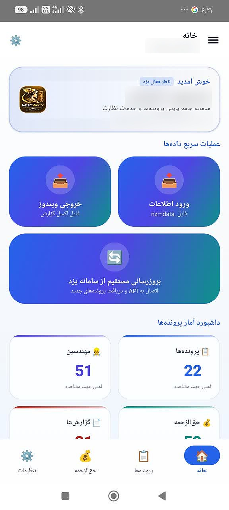
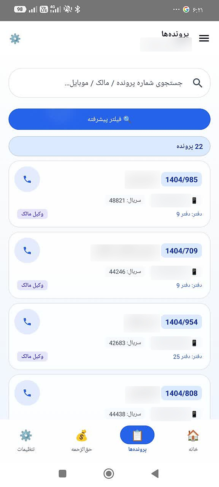
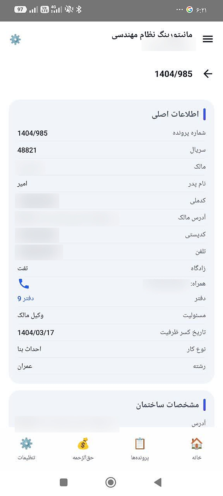
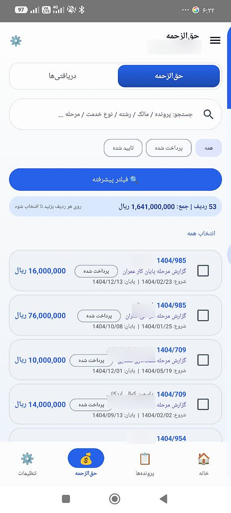
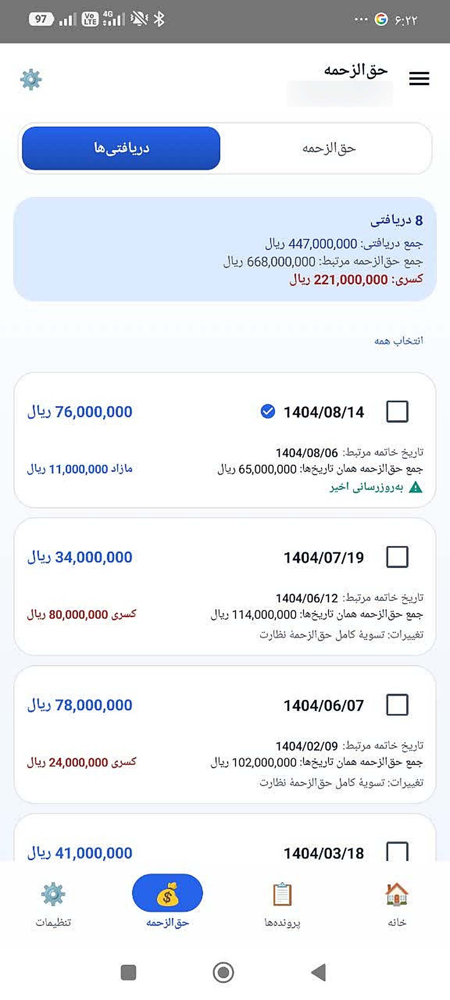
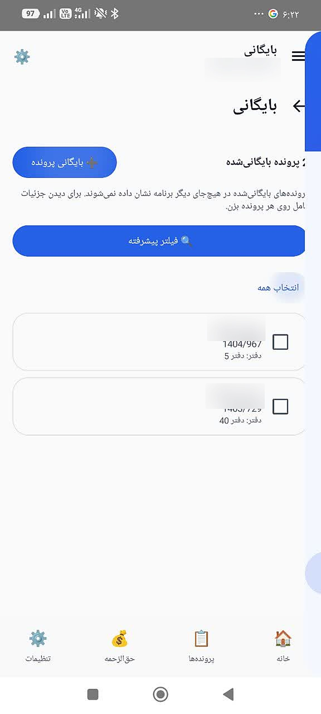
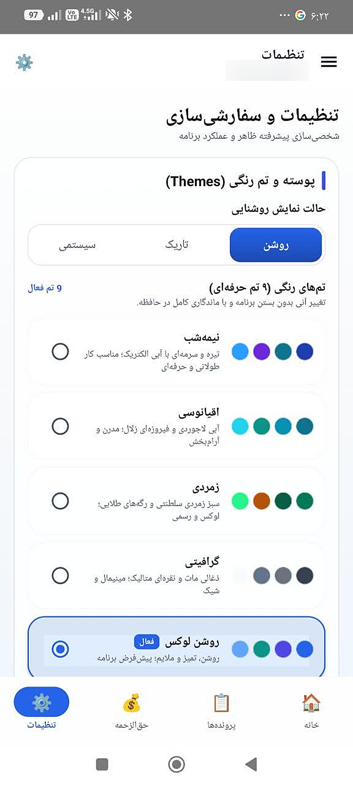

# NezamMonitor Pro — سامانهٔ همراه مدیریت پرونده‌های نظام مهندسی 📱

> نسخهٔ موبایل نرم‌افزار مدیریت پرونده‌های نظام مهندسی — همگام با نسخهٔ ویندوز

**نسخهٔ کنونی: 3.11.8** (کد نسخهٔ ۸۳) — [دانلود آخرین نسخه](https://github.com/Barkhordari-dev/NezamMonitor-Android-UI/releases/tag/v3.11.8)

🖥️ **نسخهٔ ویندوز:** [NezamMonitor](https://github.com/Barkhordari-dev/NezamMonitor) — برای رایانه؛ داده‌ها میان دو نسخه با فایل `.nzmdata` جابه‌جا می‌شوند.

---

## این برنامه برای چه کسی است و چه کار می‌کند؟

NezamMonitor Pro همراهِ مهندسان ناظر و طراحِ عضو سازمان نظام مهندسی استان یزد است که از سامانهٔ [service.yazdnezam.ir:8033/panel](http://service.yazdnezam.ir:8033/panel/) استفاده می‌کنند؛ همهٔ کارهایی را که پیش‌تر فقط پشت رایانه و با نسخهٔ ویندوز انجام می‌شد، روی گوشی هم در دسترس می‌گذارد: دیدن پرونده‌ها، پیگیری حق‌الزحمه و دریافتی‌ها، ثبت گزارش بازدید، بایگانی پرونده‌های تمام‌شده و ساختن گزارش Word — بدون نیاز به رایانه و حتی بدون اینترنت (برای بیشتر کارها).

داده‌ها روی خودِ گوشی ذخیره می‌شوند و هر وقت بخواهید می‌توانید آن‌ها را با نسخهٔ ویندوز جابه‌جا کنید یا مستقیم از سامانهٔ یزد به‌روز کنید.

## نمایی از برنامه

| خانه | پرونده‌ها | جزئیات پرونده |
|---|---|---|
|  |  |  |
| داشبورد آمار، ورود و خروج داده و به‌روزرسانی مستقیم از سامانه | جستجو، فیلتر و تماس با مالک | همهٔ اطلاعات پرونده، مشخصات ساختمان و دفتر |

| حق‌الزحمه | دریافتی‌ها | بایگانی | تنظیمات و تم‌ها |
|---|---|---|---|
|  |  |  |  |
| انتخاب چندتایی و جمع ریالی دقیق | مغایرت دریافتی با حق‌الزحمه | پرونده‌های آرشیوی، جدا از بقیه | ۹ تم حرفه‌ای، روشن و تاریک |

> در تصویرها نام‌ها و شماره‌های تماس برای حفظ حریم خصوصی محو شده‌اند.

## امکانات

| بخش | چه کاری انجام می‌دهد؟ |
|---|---|
| 📋 پرونده‌ها | مشاهده، جستجو و مرتب‌سازی پرونده‌ها؛ تماس مستقیم با مالک با یک لمس |
| 👷 مهندسین و دفترچه | اطلاعات مهندسین و دفترها، همراه با شماره تماس و پایه‌ها |
| 💰 حق‌الزحمه | گروه‌بندی پرونده‌ای، انتخاب چندتایی و جمع ریالی دقیق؛ پشتیبانی از اعداد فارسی و عربی |
| 🧾 دریافتی‌ها | لیست دریافتی‌ها و مقایسهٔ آن با حق‌الزحمه؛ نمایش مازاد و کسری هر تاریخ |
| 📄 گزارش‌ها و پیگیری | گزارش‌های ثبت‌شدهٔ هر پرونده و ویرایش توضیحات پیگیری |
| 🗄️ بایگانی | پرونده‌های آرشیوی فقط در صفحهٔ بایگانی دیده می‌شوند و در بقیهٔ بخش‌ها پنهان‌اند |
| 🔄 به‌روزرسانی مستقیم | دریافت پرونده‌ها از سامانهٔ یزد با نام کاربری و رمز سامانه — بدون نیاز به ویندوز |
| 📊 تولید گزارش Word | ساخت گزارش مرحلهٔ اول، دوم و سوم با قالب Word و اعداد فارسی؛ خروجی PDF از همان قالب |
| 📥 وارد کردن و 📤 خروجی | تبادل داده با نسخهٔ ویندوز با فایل `.nzmdata` (با رمز اختیاری)؛ خروجی Excel و پایگاه دادهٔ ویندوز |
| 🎨 تم‌ها و شخصی‌سازی | ۹ تم حرفه‌ای با حالت روشن و تاریک، اندازهٔ فونت و راست‌چین |

## ✨ تازه‌های نسخهٔ 3.11.8

- **رمز منوی مخفی ثابت شد:** منوی مخفی دیگر برای باز شدن به اینترنت و پوشهٔ گوگل درایو وابسته نیست؛ بدون اینترنت هم باز می‌شود.
- **به‌روزرسانی مستقیم:** این نسخه با همان کلید نسخهٔ 3.11.7 امضا شده است؛ اگر 3.11.7 را دارید، بدون حذف نصب به‌روزرسانی می‌شود.
- نسخهٔ 3.11.8، کد نسخهٔ ۸۳.

### تازه‌های نسخهٔ 3.11.7

- **رفع مشکل راست‌به‌چپ در گزارش:** ردیف‌های توضیحاتی که در مرحلهٔ سوم ویزارد گزارش اضافه می‌کنید، حالا در فایل Word درست راست‌چین نوشته می‌شوند.
- **مرحلهٔ تازهٔ «متن کامل»:** ویزارد گزارش پنج مرحله‌ای شد؛ در مرحلهٔ چهارم می‌توانید متن کامل گزارش را پیش از ساخت، بخوانید و ویرایش کنید.

## 📥 دانلود و نصب

**ریلیز رسمی v3.11.8:** [Releases](https://github.com/Barkhordari-dev/NezamMonitor-Android-UI/releases/tag/v3.11.8)

| فایل | توضیح |
|------|-------|
| NezamMonitor-v3.11.8-release-signed.apk | نسخهٔ اصلی (امضاشده، مناسب نصب مستقیم روی گوشی) |

### نصب

1. فایل APK را دانلود کنید.
2. در تنظیمات امنیت گوشی، «نصب از منابع ناشناخته» را فعال کنید.
3. فایل APK را نصب کنید.
4. یکی از دو راه را انتخاب کنید: **ورود مستقیم** با نام کاربری و رمز سامانه (به‌روزرسانی) یا **وارد کردن فایل `.nzmdata`** از ویندوز.

> **⚠️ نکتهٔ مهم نصب:** اگر نسخهٔ 3.11.7 را دارید، این نسخه مستقیم روی آن نصب می‌شود. اگر نسخهٔ قدیمی‌تر دارید، اول از داخل برنامه از داده‌ها خروجی `.nzmdata` بگیرید، نسخهٔ قبلی را حذف کنید و بعد این نسخه را نصب کنید.

## 📋 نیازمندی‌ها

- **اندروید:** 8.0 (API 26) یا بالاتر
- **حجم:** حدود ۲۸ مگابایت (نسخهٔ ریلیز)
- **پیش‌نیاز:** حساب سامانهٔ یزد یا فایل `.nzmdata` از نسخهٔ ویندوز

## 🔗 ارتباط با نسخهٔ ویندوز

تبادل داده میان گوشی و ویندوز با فایل `.nzmdata` انجام می‌شود:

```
ویندوز → خروجی → .nzmdata → اندروید → وارد کردن
اندروید → ویرایش پیگیری → خروجی → ویندوز → وارد کردن
یا مستقیم: اندروید → به‌روزرسانی (API) → بدون ویندوز
```

نسخهٔ 3.11.8 اندروید با ویندوز نسخهٔ ۱۲ به بعد همگام است. بستهٔ `.nzmdata` می‌تواند رمزدار باشد (AES-256-GCM) و صحت آن با checksum بررسی می‌شود؛ پرونده‌های آرشیوی در همهٔ بخش‌ها پنهان می‌مانند، به‌جز صفحهٔ بایگانی.

- **نسخهٔ ویندوز:** [Barkhordari-dev/NezamMonitor](https://github.com/Barkhordari-dev/NezamMonitor)

## 🏗️ برای کاربران سامانهٔ سینا

اگر از سامانهٔ سینا استفاده می‌کنید، این برنامه مستقیم با سامانهٔ شما کار نمی‌کند؛ اما سورس برنامه در همین مخزن در دسترس است و می‌توانید با استفاده از آن، نسخهٔ مورد نظر خودتان را بسازید.

## 🔒 حریم خصوصی

- همهٔ داده‌های شما (پرونده‌ها، حق‌الزحمه، گزارش‌ها) فقط روی گوشی شما ذخیره می‌شوند.
- برنامه هیچ داده‌ای را به جایی ارسال نمی‌کند و تبلیغ ندارد.
- دسترسی‌های برنامه فقط اینترنت (برای همگام‌سازی با سامانه) و حافظه (برای خواندن و نوشتن فایل‌های گزارش) است.

## 📖 مستندات

- [فرمت داده .nzmdata](DataContract/DataFormat.md)
- [مستندات کامل](DOCUMENTATION.md)

## 🛠️ توسعه‌دهندگان

```bash
git clone https://github.com/Barkhordari-dev/NezamMonitor-Android-UI.git
cd NezamMonitor-Android-UI
./gradlew assembleDebug
```

- **compileSdk 34, minSdk 26, Kotlin 1.9.10, AGP 8.1.0, Room 2.6.1, Compose BOM 2023.10.01**

## 📞 پشتیبانی

- **Issues:** [ایجاد مشکل](https://github.com/Barkhordari-dev/NezamMonitor-Android-UI/issues)
